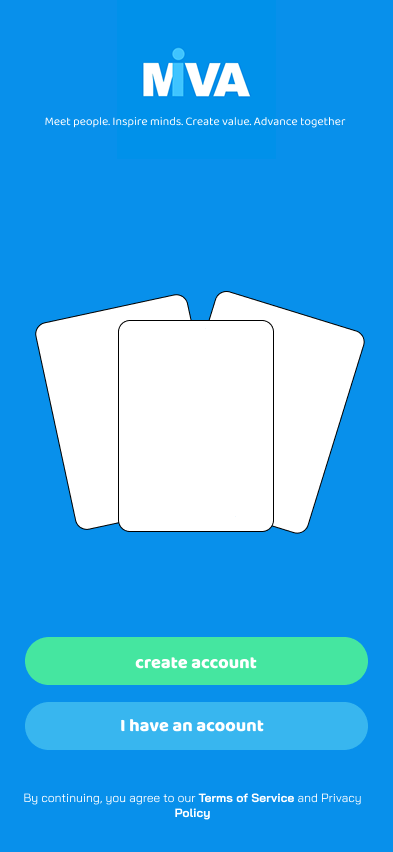
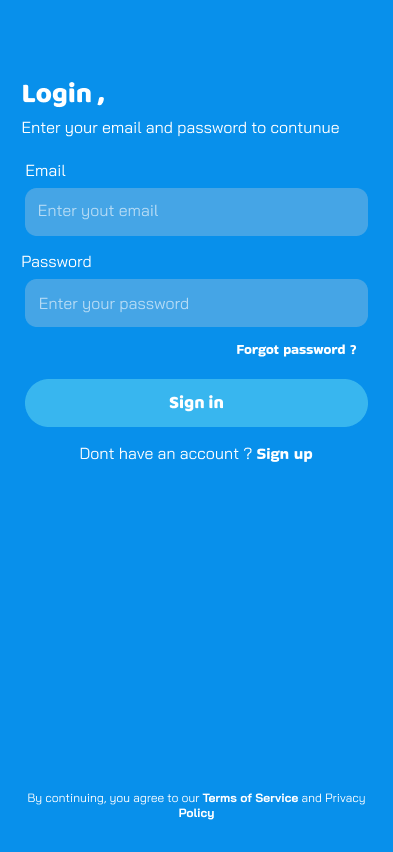
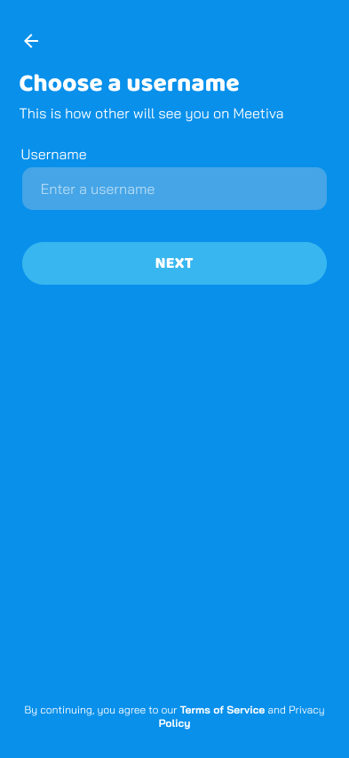
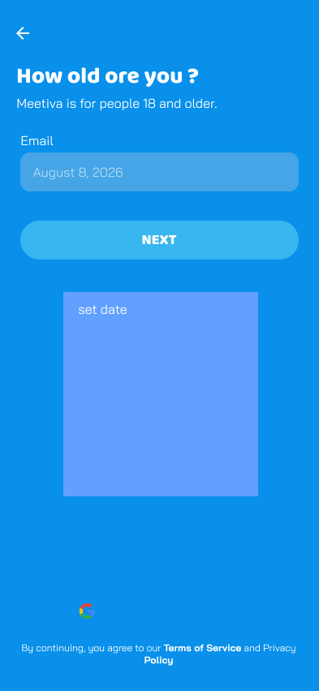

## 📱 App Screenshots

### Onboarding

  
  

### Authentication

  
  
  
  
  
  
  

### App

  
  
  

# Meetiva

### Meet. Inspire. Value. Advance.

### *Meet the right people. Not random people.*

AI-powered interest-based networking platform built with React Native, Node.js, PostgreSQL, WebRTC and OpenAI.

---

#  About

Meetiva is a mobile platform designed to connect people through meaningful one-to-one video conversations based on shared interests, expertise, and learning goals.

Unlike traditional random chat applications, Meetiva matches users according to their passions and professional interests, creating valuable conversations instead of random encounters.

Whether you're a developer looking for another developer, a cybersecurity enthusiast searching for like-minded people, or an artist wanting to exchange ideas, Meetiva helps you find the right person.

---

#  The Problem

Random video chat platforms often suffer from:

- Random and irrelevant matches
- Spam and fake accounts
- Harassment and abusive behavior
- Low-quality conversations
- No shared interests between participants

These issues reduce user engagement and create an unsafe experience.

---

#  The Solution

Meetiva introduces an intelligent networking experience by connecting people based on common interests instead of randomness.

Users can:

- Create a personal profile
- Select one or multiple interests
- Find people with similar passions
- Start secure one-to-one video calls
- Report inappropriate behavior
- Build meaningful conversations

---

#  AI Trust & Safety

Artificial Intelligence is integrated as a **Trust & Safety Assistant**.

Instead of replacing human moderators, the AI assists them by analyzing reports and evidence submitted by users.

The AI can:

- Analyze user reports
- Read screenshots submitted as evidence
- Compare evidence against Community Guidelines using RAG
- Detect potential violations
- Generate structured moderation summaries
- Recommend moderation actions

The final moderation decision is **always made by a human moderator**.

---

# AI Boundaries

### The AI can

- Analyze reports
- Understand screenshots
- Summarize evidence
- Classify violations
- Recommend moderation actions

### The AI cannot

- Automatically ban users
- Access private conversations without a report
- Replace human moderators
- Make legal decisions
- Execute irreversible actions

---

# Features

- Secure Authentication
- JWT Authorization
- Interest-Based Matching
- One-to-One Video Calls
- Real-time Communication
- AI-Powered Moderation
- User Reporting System
- Community Guidelines
- Admin Dashboard
- Responsive Mobile Experience

---

#  Tech Stack

## Mobile

- React Native
- Expo
- TypeScript
- Expo Router
- Zustand
- Axios

## Backend

- Node.js
- Express.js
- PostgreSQL
- Prisma ORM
- JWT Authentication
- Socket.IO
- WebRTC

## Artificial Intelligence

- OpenAI API
- Retrieval-Augmented Generation (RAG)
- pgvector
- Streaming Responses

## DevOps

- Docker
- Railway
- Swagger / OpenAPI
- Postman

---

#  Target Users

- Developers
- Cybersecurity Professionals
- Designers
- Students
- Researchers
- Language Learners
- Professionals
- Hobby Communities

---

#  Future Roadmap

- Friends System
- Interest Communities
- Scheduled Meetings
- AI Translation
- Screen Sharing
- Reputation Score
- Professional Networking
- Learning Recommendations

---

#  Project Goals

Meetiva aims to transform online networking by making every conversation intentional, relevant, and safe through intelligent matching and AI-assisted moderation.

---

##  License

This project was developed as a full-stack mobile application for educational purposes using modern software engineering practices and AI integration.

## Academic Review Notice

This repository may be shared temporarily with instructors, mentors, or authorized reviewers strictly for academic evaluation, code review, debugging, or assessment purposes.

Such access does not grant permission to copy, reuse, redistribute, publish, or commercialize any part of the project.

All intellectual property rights remain exclusively owned by the project author unless otherwise agreed in writing.
